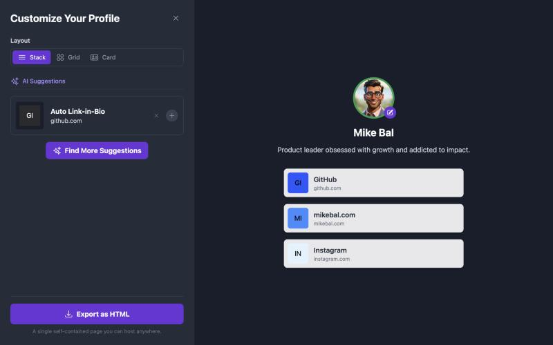
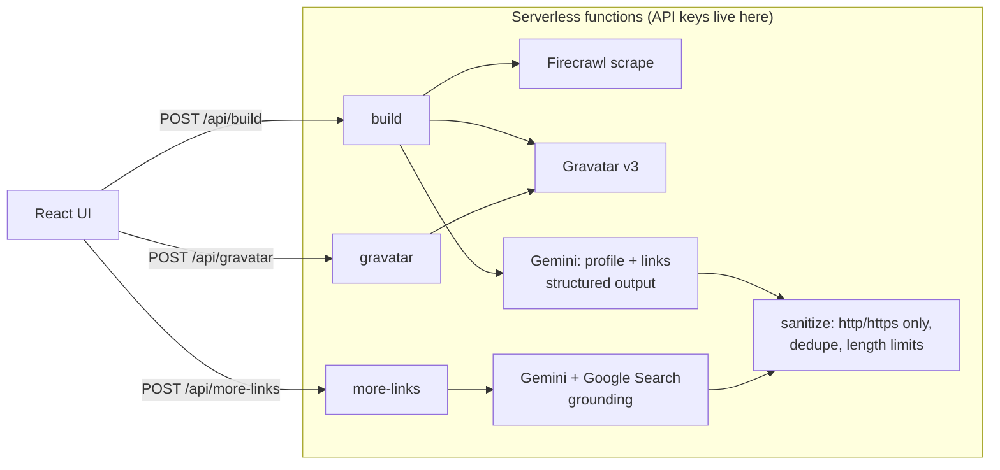

# Auto Link-in-Bio

**Paste one URL. An AI agent builds your link-in-bio page.**

Most link-in-bio tools start you from a blank page and make you hunt down every profile you've ever made. This one starts from what's already public: your Gravatar and your main website. It drafts the page for you, and you just approve or dismiss suggestions.



## What it does

1. **You enter an email and one URL** (a personal site or your main social profile).
2. **It gathers what's public.** It reads the page with [Firecrawl](https://firecrawl.dev) and looks up your [Gravatar](https://gravatar.com) profile, including the accounts you've verified there.
3. **Gemini drafts your profile.** It writes your name, a short bio, an avatar and a brand color, and pulls out the links worth featuring. Structured output keeps the responses in a fixed shape.
4. **You curate.** Add or dismiss each suggestion, pick a layout (Stack, Grid or Card) and watch the preview update live.
5. **Need more?** "Find More Suggestions" runs a Google-grounded Gemini search for profiles the crawl missed. It lists the sources it used, so you can check where each link came from.
6. **Export.** Download a single self-contained HTML page with Open Graph tags that you can host anywhere.

## How it works



**Decisions worth calling out**

- **API keys never reach the browser.** Every third-party call goes through `/api/*` serverless functions. The client bundle contains no keys and no AI SDK.
- **Model output is treated as untrusted input.** Every URL the model returns is parsed and must be `http(s)`. Links are deduped, text is length-capped and colors are checked against a hex pattern before anything is rendered or exported. The exported HTML escapes everything.
- **Known data first, inference second.** Verified Gravatar data wins over model guesses for name, bio and avatar. Gravatar-verified accounts become the first suggestions.
- **The AI search shows its sources.** Grounded search results come with the pages they came from, so users can see why a link was suggested.
- **One round trip to build.** Scraping and the Gravatar lookup run in parallel, then profile and link generation run in parallel.
- **Kept small on purpose.** Manual link entry and multi-URL crawling were cut from v1 so the core "one URL in, a page out" flow could ship polished. They're on the roadmap.

## Tech stack

React 19 · TypeScript · Vite · Tailwind CSS · Gemini 2.5 Flash (`@google/genai`) · Firecrawl · Gravatar REST API v3 and Quick Editor · Vercel Functions

## Run it locally

Requires Node 20+.

```bash
npm install
cp .env.example .env.local   # then fill in your keys
npm run dev                  # http://localhost:3000
```

| Variable | Required | Where to get it |
| --- | --- | --- |
| `GEMINI_API_KEY` | Yes | [Google AI Studio](https://aistudio.google.com/apikey) |
| `FIRECRAWL_API_KEY` | Yes | [Firecrawl dashboard](https://www.firecrawl.dev/app/api-keys) |
| `GRAVATAR_API_KEY` | No | [Gravatar developers](https://gravatar.com/developers): raises the rate limit |

In dev, a small Vite middleware runs the same `/api` handlers that Vercel runs in production, so there's nothing extra to install.

## Deploy

Import the repo into [Vercel](https://vercel.com/new) and add the environment variables above. Vercel detects Vite automatically and deploys `/api` as serverless functions.

> **Before you share a public demo:** every visit to `/api/build` uses your Firecrawl and Gemini quota. Add rate limiting (for example with Vercel's firewall rules) or put the demo behind a password.

## Project structure

```
api/          Serverless endpoints (Web-standard POST handlers)
server/       Firecrawl, Gemini and Gravatar clients, input validation, output sanitizing
components/   React UI
services/     Browser client for /api
utils/        URL helpers and the HTML exporter
```

## Roadmap

- Add and edit links manually, and reorder them by dragging
- Crawl more than one source URL
- One-click publishing to a hosted URL, not just HTML export
- Click analytics on the exported page

## License

[Apache 2.0](LICENSE)
